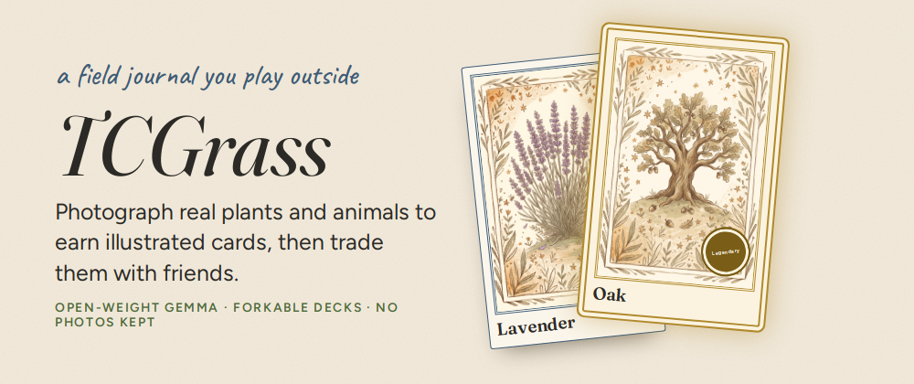
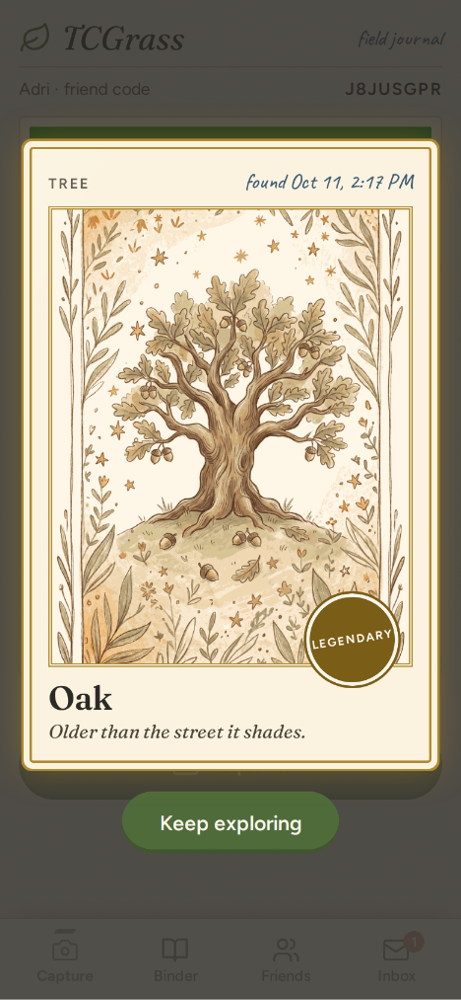
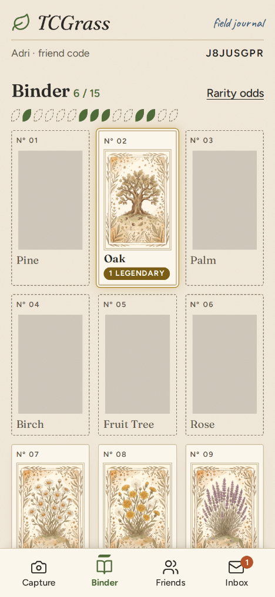
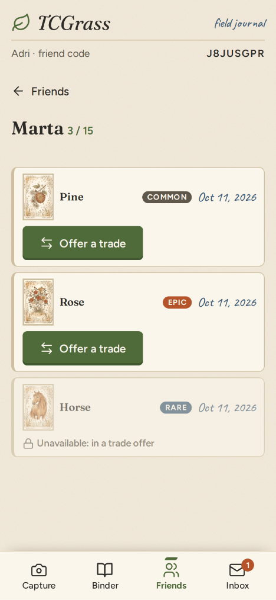
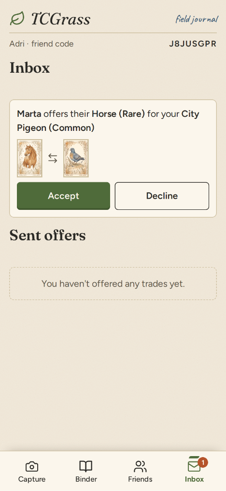
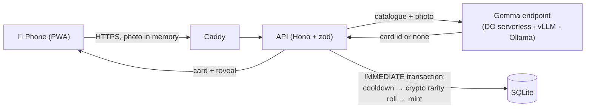

<div align="center">



# TCGrass

**A collectible card game you can only play outside.**
Photograph a real flower, tree or animal, and an open-weight Gemma model turns it into an
illustrated card for your binder. Then trade your finds with friends.

[](https://github.com/adricasi/TCGrass/actions/workflows/ci-node.yml)
[](https://github.com/adricasi/TCGrass/actions/workflows/security.yml)
[](LICENSE)
<br>
[](docs/gemma.md)
[](docs/digitalocean.md)
[](https://dev.to/challenges/hf26)
[](https://dev.to/t/hf26challenge)
[](https://dev.to/challenges/hf26)

[**Play now →** tcgrass.duckdns.org](https://tcgrass.duckdns.org/) ·
[How it works](#how-it-works) · [Gemma](docs/gemma.md) · [DigitalOcean](docs/digitalocean.md) ·
[Run it yourself](#run-it-yourself) ·
[Make your own deck](docs/expansions.md) · [Contributing](CONTRIBUTING.md)

</div>

---

## Demo Video

<p align="center">
  <a href="https://youtu.be/evgKfBRZh10">
    
  </a>
  <br>
</p>

## Contents
- [Why TCGrass](#why-tcgrass)
- [Features](#features)
- [Screenshots](#screenshots)
- [How it works](#how-it-works)
- [Powered by Gemma](#powered-by-gemma)
- [Deployed on DigitalOcean](#deployed-on-digitalocean)
- [Why open](#why-open)
- [Run it yourself](#run-it-yourself)
- [Configuration](#configuration)
- [Make your own deck](#make-your-own-deck)
- [Project structure](#project-structure)
- [Development](#development)
- [Privacy and security](#privacy-and-security)
- [Contributing](#contributing)
- [License and credits](#license-and-credits)

## Why TCGrass
Collecting cards is fun; scrolling past them is not. TCGrass flips it around: the cards live
on your phone, but you can only find them outdoors. A dandelion on the way to work, the oak in
the park, the neighbour's cat. Each one is a card, and a rare roll makes an ordinary walk feel
like a lucky pull. The screen is the shortest part of the experience: point, shoot, keep
exploring.

It was built in a week for the [DEV Hacktoberfest 2026 "Touch Grass"
challenge](https://dev.to/challenges/hf26) and field-tested outside.

## Features
- 📷 **Capture the real world.** Live camera only, with no photo uploads; the model is told to
  refuse photos of screens or printed pictures, and nothing is minted for them.
- 🌿 **Identification by Gemma.** One OpenAI-compatible endpoint: DigitalOcean serverless
  inference, vLLM on a GPU, or Ollama on your laptop.
- 🎴 **Fair rarity.** Common, Rare, Epic or Legendary is rolled on the server with `crypto`
  from the deck's published odds. Never by the model, never by the client.
- 📖 **A binder to complete.** Numbered cards, counts per rarity and silhouettes for what you
  haven't found yet.
- 🤝 **Friends and 1:1 trades.** Add friends by code, offer one of your cards for one of theirs,
  and accept or decline in your inbox. Swaps are atomic, and a card in an open offer is locked.
- ⏳ **Built-in fair play.** A per-card capture cooldown and daily caps keep it outdoors and
  keep inference costs bounded.
- 🧩 **Open, forkable decks.** An expansion is a YAML file plus an image folder. Fork one and
  play your own city, garden or trail.
- 📱 **Installable PWA.** Add to the home screen on Android and iOS; no app store.

## Screenshots
| Reveal | Binder | Friend's binder | Inbox |
|:---:|:---:|:---:|:---:|
|  |  |  |  |

## How it works


1. The PWA grabs a frame from the live camera, downsizes it and sends it to the API.
2. The API asks Gemma to match the photo to one card in the active deck's catalogue, using the
   deck's identification hints. The answer is validated with zod against the catalogue ids;
   anything else counts as "no card".
3. The photo is dropped from memory in a `finally` block. It is never written to disk, the
   database or the logs.
4. In one SQLite transaction the server checks the capture cooldown, rolls the rarity with
   `crypto.randomInt` from the deck's odds and mints a card instance you own.
5. The phone plays the reveal: a flip for Common and Rare, a spin with a gilt glow for Epic and
   Legendary.

Design details: [docs/spec/design.md](docs/spec/design.md) and the
[architecture decision records](docs/adr/).

## Powered by Gemma
Every capture is one call to Google's open-weight **Gemma** vision model. Full write-up with code
links: **[docs/gemma.md](docs/gemma.md)**.

- **Models:** Gemma 4 31B (`gemma-4-31B-it`) on DigitalOcean serverless inference in production;
  Gemma 4 E4B (`gemma4:e4b`) on Ollama for local play; any Gemma on vLLM.
- **The deck is the prompt:** the system prompt is built from the active expansion's catalogue
  and identification hints ([`prompt.ts`](src/server/identify/prompt.ts)), so a forked deck
  changes what Gemma recognises without code changes.
- **One OpenAI-compatible call** with the photo as an image part, JSON output, a 30 s timeout,
  no redirects and at most 5 calls in flight ([`client.ts`](src/server/identify/client.ts)).
- **Untrusted output:** zod checks `card_id` against the catalogue
  ([`answer.ts`](src/server/identify/answer.ts)); a fixed decision order handles screens,
  "none" and low confidence; flavor lines are cleaned and shown as plain text.
- **Gemma never picks the rarity:** the server rolls it with `crypto` in the mint transaction.
- **Measured:** 18/18 correct with `gemma4:e4b` on Ollama and 17/19 (89 %) with
  `gemma-4-31B-it` on DigitalOcean, on a labelled set of AI-generated photos
  ([`spike-identify.ts`](scripts/spike-identify.ts)).

## Deployed on DigitalOcean
The whole stack runs on DigitalOcean. Architecture, costs and pipeline:
**[docs/digitalocean.md](docs/digitalocean.md)**; runbook: [docs/deploy.md](docs/deploy.md).

| Product | Used for |
|---|---|
| Serverless inference | Gemma 4 31B identifies every capture (pay per token, ≈ $0.0003 per capture, daily caps) |
| Droplet + Volume + Reserved IP | Ubuntu 24.04 (1 GB) running Caddy and the API with Docker Compose; SQLite, logs and backups on a 10 GB Volume |
| Cloud Firewall | Only 80/443 public; SSH from the operator's IP |
| Container Registry | Images built in GitHub Actions, deployed by digest by a pull agent on the Droplet |
| Projects, tags, monitoring, billing alert | Organisation, metrics and a spending guard |

GitHub never connects to the Droplet: CI pushes images to DOCR, and a systemd timer on the
Droplet pulls each approved release by digest, seeds, starts it and rolls back if it isn't
healthy.

## Why open
- **Swap the model, keep the game.** Every inference path speaks the same OpenAI-compatible API.
  Production runs Gemma on DigitalOcean serverless inference; changing `INFERENCE_BASE_URL` and
  `INFERENCE_MODEL` (and the key) moves it to vLLM on your own GPU or to Ollama on a laptop
  ([ADR 0003](docs/adr/0003-call-gemma-through-an-openai-compatible-endpoint.md)).
- **Your photos go only where you point them.** Self-host with Ollama and a photo never
  leaves your network. TCGrass itself keeps none.
- **The game content is data, not code.** Decks are open YAML with their own licence, so
  anyone can fork one for their town, school or hiking club without touching the code.
- **Cheap to run.** One small Droplet, SQLite and a daily call cap
  ([ADR 0006](docs/adr/0006-run-production-inference-on-do-serverless-with-a-daily-cap.md)).

## Run it yourself

### Prerequisites
- Node.js 22.12 or later (24 LTS recommended; the UI tests need 22.22+ or 24.15+) and npm
- An OpenAI-compatible endpoint serving a Gemma vision model, for example
  [Ollama](https://ollama.com/) with `gemma4:e4b`
- A phone or laptop with a camera (browsers only allow the camera on `https://` or `localhost`)

### Quick start: local development with Ollama
```bash
git clone https://github.com/adricasi/TCGrass.git && cd TCGrass
npm ci
ollama pull gemma4:e4b

cp .env.example .env
# In .env set:
#   INFERENCE_BASE_URL=http://localhost:11434/v1
#   INFERENCE_MODEL=gemma4:e4b

npm run seed -- expansions/everyday-nature   # load the deck into .dev/tcgrass.db
npm run dev:api                              # API on http://localhost:3000
npm run dev:web                              # PWA on http://localhost:5173 (proxies /api)
```
Open the PWA URL that Vite prints, allow the camera and photograph something green.

### Self-host with Docker Compose
Caddy terminates HTTPS (Let's Encrypt) in front of the API, which serves the PWA, card art and
`/api`, with SQLite in `DATA_DIR`:
```bash
cp .env.example .env          # set PUBLIC_HOSTNAME, DATA_DIR and the INFERENCE_* values
mkdir -p data && sudo chown 1000:1000 data    # the API runs as uid 1000
docker compose build
docker compose run --rm api node dist/server/seed-cli.js expansions/everyday-nature
docker compose up -d
```
- **Ollama on the same machine:** add `-f compose.yaml -f compose.local.yaml` after
  `docker compose`; see [docs/deploy.md § Local run](docs/deploy.md#local-run-nfr-011).
- **Production on a DigitalOcean Droplet:** releases are built in CI, stored in DigitalOcean
  Container Registry and pulled by the Droplet
  ([ADR 0008](docs/adr/0008-release-through-docr-and-pull-on-the-droplet.md)). Full runbook:
  [docs/deploy.md](docs/deploy.md).

## Configuration
Settings come from the environment (`.env`); see [`.env.example`](.env.example). "Required" means the API (or Compose) refuses to start without it.

| Variable | Default | What it does |
|---|---|---|
| `INFERENCE_BASE_URL` | required | OpenAI-compatible base URL up to `/v1` |
| `INFERENCE_MODEL` | required | Model name, e.g. `gemma4:e4b` or `gemma-4-31B-it` |
| `INFERENCE_API_KEY` | empty | Bearer key for the endpoint (secret; empty for Ollama) |
| `IDENTIFY_MIN_CONFIDENCE` | `0.5` | Minimum model confidence to mint a card (0–1) |
| `ACTIVE_EXPANSION` | required (`everyday-nature` in `.env.example`) | Deck folder under `expansions/`; the server won't start if it isn't seeded |
| `CAPTURE_COOLDOWN_HOURS` | `5` | Hours before you can capture the same card again (`0` = off) |
| `INFERENCE_DAILY_CALL_LIMIT` | `3000` | Model calls per UTC day for everyone (`0` pauses captures) |
| `CAPTURES_PER_PLAYER_PER_DAY` | `30` | Captures per player per UTC day |
| `PUBLIC_HOSTNAME` | required for Compose (`localhost` in `.env.example`) | Hostname Caddy serves and gets a certificate for |
| `DATA_DIR` | required for Compose (`./data` in `.env.example`) | Host folder for the DB, logs and backups |
| `DATABASE_PATH` | required locally (`.dev/tcgrass.db` in `.env.example`; Compose sets it) | SQLite file |
| `PORT` | `3000` | API port (local development) |
| `LOG_LEVEL` | `info` | `fatal` … `trace` |
| `LOG_FILE_PATH` | empty | Also append JSON logs to this file (Compose sets it to the data volume) |
| `TRUST_PROXY` | `false` | `true` only behind Caddy, so rate limits use the client IP |
| `PUBLIC_URL` | `https://tcgrass.duckdns.org` | **Build time:** origin for link previews and the canonical URL. Compose passes it from `.env` to the image build (`docker compose build`); without Docker: `PUBLIC_URL=https://you.example npm run build` |

## Make your own deck
A deck ("expansion") is `expansions/<id>/expansion.yaml` plus one image per card in
`expansions/<id>/images/`. It sets the cards, their identification hints, the rarity odds and
its own licence. The step-by-step guide, from forking to seeding, is in
**[docs/expansions.md](docs/expansions.md)**.

## Project structure
```text
src/server/     Hono API: routes, identification, game services (mint, trades), seed, backups
src/shared/     zod schemas shared by the API and the PWA (requests, responses, expansions)
web/            Vite + Preact PWA (Field Journal design, manifest, service worker)
expansions/     Decks: expansion.yaml + images/
deploy/droplet/ Release agent and systemd units for the Droplet
test/           Vitest: server, web helpers, UI components (jsdom), deploy agent
docs/           Spec, ADRs, deploy runbook, style guide, expansion guide
```

## Development
```bash
npm test                              # all tests (npm test -- --coverage)
npm run lint && npm run typecheck     # ESLint (type-checked) + TypeScript
npm run format                        # Prettier
npm run build                         # server to dist/, PWA to dist/web
npm audit --audit-level=high          # dependency vulnerabilities
npm run load                          # 5 parallel captures against a stub model
```
- **Tech:** TypeScript (strict, ESM) on Node.js, Hono, zod, better-sqlite3 (WAL), Vite,
  Preact, Vitest, Docker Compose, Caddy.
- **Spec-driven:** requirements live in [docs/spec](docs/spec/) with stable IDs, and test
  names start with the acceptance criterion they prove (e.g. `AC-010.3 …`).
- **Design system:** [docs/design/style-guide.md](docs/design/style-guide.md).
- **Identification test set:** `spike-photos/` holds labelled, AI-generated images (no real
  people or places) for `npm run spike -- spike-photos`, which measures accuracy against your
  endpoint.

## Privacy and security
- **Photos are never stored.** They are held in memory for one request, sent only to the
  configured inference endpoint and discarded; tests check the database, its WAL and the log
  file for image data.
- **No accounts, no email.** A player is a random secret kept on the device and stored only as
  a SHA-256 hash on the server. It's sent in a header, never logged and never shown to others.
- **Untrusted model output.** Answers are validated against the catalogue; flavor text is
  rendered as plain text.
- **Hardened by default.** Strict Content Security Policy (`'self'` only, no third-party
  scripts or fonts), HSTS, rate limits, a read-only container running as non-root.
- **Inference provider:** in production, photos are sent to DigitalOcean serverless inference
  under DigitalOcean's terms. Self-host with Ollama or vLLM to keep them on your own machine.

Found a vulnerability? Please report it privately; see [SECURITY.md](SECURITY.md).

## Contributing
Contributions are welcome: new decks, bug fixes, accessibility improvements and ideas. Read
[CONTRIBUTING.md](CONTRIBUTING.md) and the [Code of Conduct](CODE_OF_CONDUCT.md) first.

## License and credits
- **Code:** [MIT](LICENSE) © 2026 adricasi.
- **Everyday Nature deck data:** Apache-2.0
  ([expansion.yaml](expansions/everyday-nature/expansion.yaml)).
- **Card art:** AI-generated with the Gemini app (Google); see the expansion's `license.images`.
- **Fonts:** Fraunces, Figtree and Caveat (SIL OFL 1.1). **Icons:** Lucide (ISC/MIT). Details:
  [THIRD_PARTY_NOTICES.md](THIRD_PARTY_NOTICES.md).
- **Model:** [Gemma](https://ai.google.dev/gemma) by Google, used under the
  [Gemma Terms of Use](https://ai.google.dev/gemma/terms); TCGrass calls it, it doesn't
  redistribute the weights.
- **Hosting:** runs on [DigitalOcean](https://www.digitalocean.com/) (Droplet, Volumes, Container
  Registry, serverless inference) under DigitalOcean's terms of service; see
  [docs/digitalocean.md](docs/digitalocean.md).
- **Built with AI assistance:** developed spec-first with Claude Code as the coding agent and
  Gemini as a reviewer; every change was reviewed and tested by a human.
