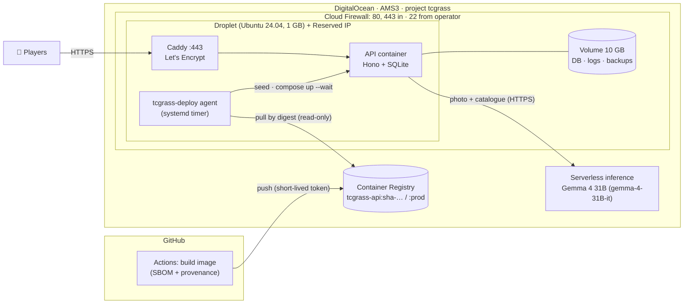

# TCGrass on DigitalOcean

TCGrass runs entirely on DigitalOcean: the app on a Droplet, the model on **DigitalOcean
serverless inference** (Gemma 4), and the release images in **DigitalOcean Container Registry**.
Live at **https://tcgrass.duckdns.org/**. This page explains what is deployed and why; the
step-by-step runbook is [deploy.md](deploy.md).

## What is deployed

| DigitalOcean product | How TCGrass uses it | Why |
|---|---|---|
| **Serverless inference** (DigitalOcean Inference) | Identifies every capture with Google's **Gemma 4 31B** (`gemma-4-31B-it`) through its OpenAI-compatible endpoint `https://inference.do-ai.run/v1` | No GPU to run or pay for while idle; pay per token (≈ $0.0003 per capture); scales with players. Details: [gemma.md](gemma.md) |
| **Droplet** | Ubuntu 24.04 LTS, Basic 1 GB, AMS3, monitoring on, SSH keys only; runs Docker Compose with Caddy and the API | One small server is enough for a game whose heavy lifting is the model call ([ADR 0002](adr/0002-host-on-a-single-digitalocean-droplet.md)) |
| **Volumes** | 10 GB ext4 at `<VOL>/tcgrass`: SQLite database, JSON logs, 7 daily backups | Data survives rebuilding or resizing the Droplet; Docker waits for it before starting |
| **Reserved IP** | The public address; the DuckDNS name `tcgrass.duckdns.org` points at it | A stable address that can move to a new Droplet; free while attached |
| **Cloud Firewall** | Inbound TCP 80/443 and UDP 443 from anywhere, TCP 22 from the operator's IP only; outbound open | Docker-published ports bypass UFW, so the cloud firewall is the real perimeter |
| **Container Registry** (DOCR) | Stores `tcgrass-api:sha-<commit>` images; `:prod` marks the release | Images are built once in CI and deployed by digest, never built on the Droplet ([ADR 0008](adr/0008-release-through-docr-and-pull-on-the-droplet.md)) |
| **Projects, tags, monitoring, billing alert** | Everything in project `tcgrass`, tagged `app:tcgrass`, `env:prod`, `owner:adricasi`, `managed-by:manual`; Droplet metrics; an account billing alert | Easy to find, audit and tear down; a second guard on spending after the app's daily caps |

**Not used, on purpose:** GPU Droplets and 1-Click Models. They were evaluated
([ADR 0006](adr/0006-run-production-inference-on-do-serverless-with-a-daily-cap.md)): an
always-on RTX 4000 Ada GPU Droplet would cost about $555/month and only breaks even above roughly
1.8 million captures a month, while serverless inference costs nothing when nobody plays. The
code still supports a GPU Droplet running vLLM for short private sessions (set
`INFERENCE_BASE_URL` to it); see [gemma.md § 6](gemma.md#6-swap-the-model-in-one-place).

## How the app runs on the Droplet
- **Caddy** terminates HTTPS with an automatic Let's Encrypt certificate for the DuckDNS name,
  redirects HTTP, and proxies to the API ([deploy.md § Domain and HTTPS](deploy.md#domain-and-https-once)).
- **The API container** serves the PWA, card art and `/api`, talks to SQLite in WAL mode on the
  Volume, and calls Gemma on serverless inference. It runs as uid 1000 with a read-only
  filesystem, no capabilities and memory/PID limits; its port is not published.
- **Backups:** the API writes one online SQLite backup per UTC day to the Volume and keeps 7.
- **Hardening:** containers can't reach the Droplet metadata service; secrets live only in
  `/opt/tcgrass/.env` (mode 600). See [deploy.md § 5 Security model](deploy.md#5-security-model).

## How a release reaches DigitalOcean
1. **Build (GitHub Actions, started by hand with "Run workflow"; that click is the approval):**
   a pinned BuildKit builds the chosen commit of `main` with an SBOM and provenance attestation;
   CI logs in to DOCR with `doctl registry login` using credentials that expire within minutes,
   and pushes `tcgrass-api:sha-<commit>` (an existing image is reused, so rollbacks are quick).
2. **Release (the same run):** the workflow points `:prod` at that image.
3. **Deploy (on the Droplet):** a systemd timer runs the `tcgrass-deploy` agent every minute. It
   resolves `:prod` to a digest with **read-only** registry credentials and, when it changes,
   pulls by digest, seeds the deck (idempotent), runs `docker compose up -d --wait` and records
   the release only once the stack is healthy. If the new release fails its health check, it
   rolls back to the previous one and skips the bad image
   ([`deploy/droplet/tcgrass-deploy`](../deploy/droplet/tcgrass-deploy), tested in
   [`test/deploy/agent.test.ts`](../test/deploy/agent.test.ts)).

GitHub never connects to the Droplet: there is no SSH key in CI and no inbound port for
deployments. Since the repository went public (2026-10-11) releases are paused until they move
to environment-gated secrets; the running app is unaffected
([deploy.md § 2e](deploy.md#2e-github-once)).

## What it costs
| Item | Monthly |
|---|---|
| Droplet Basic 1 GB + 10 GB Volume | about $7 |
| Reserved IP (attached) | $0 |
| Container Registry (starter tier, 500 MiB) | $0 |
| Serverless inference, Gemma 4 31B | about $0.0003 per capture; capped at 3,000 calls/day (≈ $1/day at most) |

Prices from DigitalOcean's pricing pages as recorded in ADR 0006 (verified 2026-10-09); check the
current pricing before relying on them.

## Run your own copy on DigitalOcean
1. Create the Droplet, Volume, Reserved IP and Cloud Firewall
   ([deploy.md § 1](deploy.md#1-infrastructure-once-by-hand-adr-0002)).
2. Point a hostname at the Reserved IP (DuckDNS or your own domain) and set `PUBLIC_HOSTNAME`.
3. Create a serverless inference access key, and set `INFERENCE_BASE_URL=https://inference.do-ai.run/v1`,
   `INFERENCE_MODEL=gemma-4-31B-it` and `INFERENCE_API_KEY` in `.env`.
4. Either use the release pipeline ([deploy.md § 2–3](deploy.md#2-prepare-the-droplet-for-releases-once-adr-0008))
   or build on the Droplet ([deploy.md § Fallback](deploy.md#fallback-build-on-the-droplet)).
