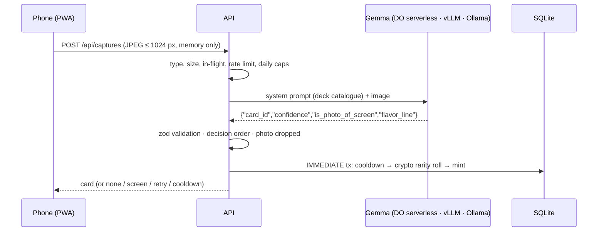

# How TCGrass uses Gemma

Gemma is the part of TCGrass that looks at the world. Every capture is one Gemma vision call: the
model sees the photo and the active deck's catalogue, and answers which card it is, whether the
photo is a picture of a screen, how sure it is, and one playful flavor line. Everything else, from
the rarity roll to ownership, is decided by the server.

- **Production:** Gemma 4 31B (`gemma-4-31B-it`) on **DigitalOcean serverless inference**
  ([ADR 0006](adr/0006-run-production-inference-on-do-serverless-with-a-daily-cap.md)).
- **Local and self-hosted:** Gemma 4 E4B (`gemma4:e4b`) on **Ollama**, or any Gemma on **vLLM**.
- **One code path for all of them:** an OpenAI-compatible Chat Completions call
  ([ADR 0003](adr/0003-call-gemma-through-an-openai-compatible-endpoint.md)), chosen by
  environment variables only.



## 1. The photo: small and private
- The PWA grabs one frame from the live camera, scales it to at most **1024 px** on the long
  edge and re-encodes it as JPEG, which also drops EXIF/GPS data
  ([`web/src/capture-frame.ts`](../web/src/capture-frame.ts)). There is no file upload.
- The API reads it into memory only and checks the real type from the file's magic bytes
  ([`src/server/routes/captures.ts` L64–L79](../src/server/routes/captures.ts#L64-L79),
  [`src/server/photo.ts`](../src/server/photo.ts)).
- After the call, the reference is dropped in `finally`
  ([L209–L212](../src/server/routes/captures.ts#L209-L212)). Photos are never written to disk,
  the database or the logs; [`test/server/photo-privacy.test.ts`](../test/server/photo-privacy.test.ts)
  checks the DB, its WAL and the log file for image data.

## 2. The prompt: the deck is the prompt
[`src/server/identify/prompt.ts`](../src/server/identify/prompt.ts) builds the system prompt from
the active expansion's YAML, so a forked deck changes what Gemma recognises without code changes:

- the deck's `identification.instructions`;
- the catalogue, one line per card: `id — name — identify_hint`
  ([`expansions/everyday-nature/expansion.yaml`](../expansions/everyday-nature/expansion.yaml));
- the exact JSON shape to answer with;
- rules learned from the spike: only the **main subject** counts (a catalogue kind in the
  background is not a match), look-alike kinds are `none`, screens/prints/drawings set
  `is_photo_of_screen`, and the flavor line must never quote text from the photo or describe
  people or places.

The first prompt forced matches on non-catalogue photos (0/3, at ≥ 0.90 confidence); stating the
"main subject" and "look-alike is none" rules fixed it (design.md § Options, spike result).

## 3. The call: OpenAI-compatible, bounded
[`src/server/identify/client.ts`](../src/server/identify/client.ts)
([L74–L119](../src/server/identify/client.ts#L74-L119)) sends one Chat Completions request:

```jsonc
POST {INFERENCE_BASE_URL}/chat/completions
{
  "model": "gemma-4-31B-it",              // INFERENCE_MODEL
  "temperature": 0.2,                      // steady answers, a little variety in flavor lines
  "response_format": { "type": "json_object" },
  "messages": [
    { "role": "system", "content": "<deck catalogue + rules>" },
    { "role": "user", "content": [ { "type": "image_url",
        "image_url": { "url": "data:image/jpeg;base64,…" } } ] }
  ]
}
```

- **Auth:** `Authorization: Bearer $INFERENCE_API_KEY` when set (DigitalOcean); none for Ollama.
- **Timeout:** 30 s (`AbortSignal.timeout`); a timeout, network or HTTP error becomes a `retry`
  answer the player can act on, never a 500.
- **No redirects** (`redirect: "error"`): a redirect would resend the photo to another host.
- **At most 5 calls in flight** ([`src/server/inflight.ts`](../src/server/inflight.ts),
  AC-003.12); a 6th concurrent capture gets `503 busy` without a model call. A separate limit
  on uploads being received is checked before any photo is read
  ([`captures.ts` L122–L131](../src/server/routes/captures.ts#L122-L131)).
- **Cost guard before the call:** 10 photos per minute per player, then the daily caps
  (3,000 calls per UTC day overall, 30 per player), reserved atomically in SQLite
  ([`src/server/game/daily-caps.ts`](../src/server/game/daily-caps.ts),
  [`captures.ts` L153–L190](../src/server/routes/captures.ts#L153-L190)).
- **Token usage** reported by the endpoint is logged per capture, so the daily cost can be
  computed from the logs ([`client.ts` L50–L58](../src/server/identify/client.ts#L50-L58)).

## 4. The answer: untrusted until validated
Model output is treated like user input:

1. **Parse:** the response must be a Chat Completion with JSON content; a Markdown code fence
   that some servers add is stripped; anything over 64 KB is rejected
   ([`client.ts` L163–L196](../src/server/identify/client.ts#L163-L196)).
2. **Validate with zod** against the deck: `card_id` must be one of the catalogue ids or
   `none`, `confidence` 0–1, `is_photo_of_screen` boolean, `flavor_line` optional
   ([`src/server/identify/answer.ts`](../src/server/identify/answer.ts)).
3. **Decide, in this order** ([`client.ts` L121–L143](../src/server/identify/client.ts#L121-L143)):
   invalid → `none`; screen → `screen`; `none` → `none`; confidence below
   `IDENTIFY_MIN_CONFIDENCE` (0.5) → `none`; otherwise `card`.
4. **Clean the flavor line:** control and bidi characters removed, cut to 140 characters
   ([L146–L157](../src/server/identify/client.ts#L146-L157)); the PWA renders it as plain text.
5. **Check again** that the card exists in the catalogue before minting
   ([`captures.ts` L228–L240](../src/server/routes/captures.ts#L228-L240)).

**What Gemma never decides:** rarity is rolled by the server with `crypto.randomInt` from the
deck's published odds ([`src/server/game/rarity.ts`](../src/server/game/rarity.ts)), inside the
same SQLite transaction as the cooldown check and the mint
([`src/server/game/mint.ts`](../src/server/game/mint.ts)). A model, or a client, can't ask for
a Legendary.

## 5. Measured quality
Both paths were measured with the same labelled set of AI-generated photos (12–13 catalogue
cards, 3 non-catalogue, 3 screens or prints) using
[`scripts/spike-identify.ts`](../scripts/spike-identify.ts) (`npm run spike -- spike-photos`):

| Model and host | Correct | Parseable | Latency p50 / p95 | Notes |
|---|---|---|---|---|
| `gemma4:e4b` on Ollama (laptop), 18 photos | 18/18 (100 %), twice | 100 % | 6.0 s / 14.8 s | Validated path for local play |
| `gemma-4-31B-it` on DO serverless, 19 photos | 17/19 (89 %) | 100 % | 9.1 s / 26.4 s | 1 timeout; the one missed screen became `none`, so nothing was minted |

Flavor lines were clean in both runs (no quoted text, no people or places). The photos are
AI-generated, not field photos, so real-world accuracy may be lower; the field test on
2026-10-11 used the production path.

## 6. Swap the model in one place
| Where Gemma runs | `INFERENCE_BASE_URL` | `INFERENCE_MODEL` | `INFERENCE_API_KEY` |
|---|---|---|---|
| DigitalOcean serverless inference | `https://inference.do-ai.run/v1` | `gemma-4-31B-it` | a DigitalOcean inference access key |
| Ollama on your machine | `http://localhost:11434/v1` | `gemma4:e4b` | empty |
| Ollama, API in Docker | `http://host.docker.internal:11434/v1` (+ `compose.local.yaml`) | `gemma4:e4b` | empty |
| vLLM on a GPU Droplet or your own GPU | `http://<host>:8000/v1` | the served Gemma name | your vLLM `--api-key` |

No code changes: the API reads these at startup ([`src/server/config.ts`](../src/server/config.ts)).
After switching models or editing a deck's hints, re-run the spike to check accuracy and latency.

## 7. Why an open-weight model matters here
- **Privacy by choice:** with Ollama or vLLM the photo never leaves your machine. With
  DigitalOcean serverless, it goes to one provider under DigitalOcean's terms, and TCGrass keeps
  none of it.
- **No lock-in:** the same weights run on a laptop, a GPU Droplet or a managed endpoint, so the
  game can move between them for cost, speed or privacy.
- **Cheap to run in public:** about $0.0003 per capture on DO serverless at the listed prices
  ($0.18 / $0.50 per 1M input / output tokens, verified 2026-10-09), with hard daily caps; an
  always-on GPU would cost about $555/month (ADR 0006).
- **Open decks:** because recognition is driven by the deck's own hints, anyone can fork the
  game for their own place and test it against their own Gemma.

## Code map
| What | Where |
|---|---|
| Prompt from the deck | [`src/server/identify/prompt.ts`](../src/server/identify/prompt.ts) |
| Answer schema | [`src/server/identify/answer.ts`](../src/server/identify/answer.ts) |
| Inference client and decision order | [`src/server/identify/client.ts`](../src/server/identify/client.ts) |
| Wiring at startup | [`src/server/startup.ts`](../src/server/startup.ts) |
| Capture route (checks, call, mint) | [`src/server/routes/captures.ts`](../src/server/routes/captures.ts) |
| Daily caps and in-flight limit | [`src/server/game/daily-caps.ts`](../src/server/game/daily-caps.ts), [`src/server/inflight.ts`](../src/server/inflight.ts) |
| Frame capture in the browser | [`web/src/capture-frame.ts`](../web/src/capture-frame.ts) |
| Accuracy spike | [`scripts/spike-identify.ts`](../scripts/spike-identify.ts) |
| Tests | [`identify.test.ts`](../test/server/identify.test.ts), [`captures.test.ts`](../test/server/captures.test.ts), [`daily-caps.test.ts`](../test/server/daily-caps.test.ts), [`photo-privacy.test.ts`](../test/server/photo-privacy.test.ts) |
| Requirements | [REQ-003, REQ-004, REQ-012 in requirements.md](spec/requirements.md) |
