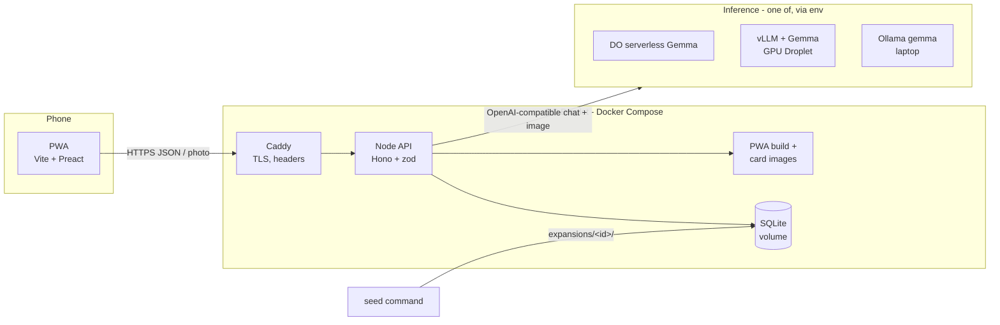

# Design: TCGrass

- Status: Approved (2026-10-08) <!-- Draft | In review | Approved -->
- Last updated: 2026-10-09 (T-001 spike result recorded; Q-7 production path still open)
- Implements: requirements.md (REQ-*, NFR-*)

## Overview
A Preact PWA runs on the player's phone. It takes a photo with the live camera, downscales it
and posts it to a Node API (Hono) on one DigitalOcean Droplet behind Caddy (HTTPS). The API
sends the photo to Gemma through one OpenAI-compatible endpoint, validates the answer against
the active expansion's catalogue and drops the photo. On a match it rolls rarity and mints a
card instance in SQLite. Friends, trades and the daily pack are plain JSON endpoints over
the same SQLite file; every state change runs in one IMMEDIATE transaction. Expansions are
folders in the repo, validated and loaded by a seed command.

## Options considered
| Topic | Options | Chosen | ADR |
|---|---|---|---|
| Hosting | 1 CPU Droplet + Compose · App Platform + Managed Postgres · all on GPU Droplet · GCP | 1 CPU Droplet + Compose | [0002](../adr/0002-host-on-a-single-digitalocean-droplet.md) |
| Inference access | One OpenAI-compatible client · per-provider adapters | One client, env-configured | [0003](../adr/0003-call-gemma-through-an-openai-compatible-endpoint.md) |
| Datastore | SQLite (better-sqlite3) · Managed Postgres · `node:sqlite` | SQLite + better-sqlite3 | [0004](../adr/0004-store-game-state-in-sqlite.md) |
| Stack / layout | Hono + Preact · Fastify + React · Express + vanilla; workspaces vs one package | Hono + zod, Vite + Preact, one package | [0005](../adr/0005-use-hono-and-preact-in-one-typescript-package.md) |

The inference **path** (DO serverless vs vLLM on GPU Droplet vs Ollama) is decided by the
hour-1 spike (product.md Q-7) and needs no design change.

**Spike result (T-001, 2026-10-09).** Validated path: **Ollama 0.35 on the author's laptop,
model `gemma4:e4b`**. 18 labelled photos (12 catalogue, 3 non-catalogue, 3 screen/print):
100 % correct in two consecutive runs (12/12 matched, 3/3 none, 3/3 screen), 100 % parseable,
no flavor line quoting photo text or describing people/places. Latency p50 6.0 s / p95 14.8 s,
which misses NFR-004 (p95 ≤ 8 s) on that hardware. An earlier run with the first prompt gave
0/3 on non-catalogue photos (forced matches at ≥ 0.90 confidence); the prompt now states that
only the main subject counts and that look-alike kinds are "none". The photos are AI-generated,
not field photos, so accuracy may be optimistic. Production path: still open (Q-7).

## Components
| Component | Responsibility | Tech / service | Requirements |
|---|---|---|---|
| PWA (`web/`) | First-run notice + name, camera capture + downscale, reveal, binder, odds, friends, inbox (polling), trades, daily pack | Vite, Preact, TypeScript, vite-plugin-pwa | REQ-002, 003, 005–011, 013 |
| Shared schemas (`src/shared/`) | zod schemas + types for API requests/responses and the expansion file | zod | NFR-001 |
| API (`src/server/`) | HTTP routes, auth middleware, rate limits, security headers (set here only, not in Caddy), static files | Hono + `@hono/node-server` on Node.js LTS (`engines` ≥ 22; Docker image uses the current LTS) | all REQ |
| Identification (`src/server/identify/`) | Build the prompt from the catalogue, call the endpoint with a 30-s timeout, at most 5 calls in flight (AC-003.12), validate the answer | OpenAI-compatible HTTP via `fetch` + `AbortSignal.timeout` | REQ-003, 004, 012 |
| Game services (`src/server/game/`) | Rarity roll, minting, binder, friends, trades, daily pack; transactions | better-sqlite3 | REQ-005, 007–011, NFR-009 |
| Expansion loader (`src/server/expansion/`, `npm run seed`) | Parse + validate YAML, check images, upsert into DB | `yaml` + zod | REQ-001 |
| Expansions (`expansions/<id>/`) | `expansion.yaml` + `images/<card id>.png` | files in repo | REQ-001, G-4 |
| Reverse proxy | TLS (Let's Encrypt), HTTP→HTTPS (308), body size cap, compression, sets `X-Forwarded-For` | Caddy 2 | NFR-001 |
| Datastore | Game state | SQLite file (WAL) on a DO Volume | ADR 0004 |
| Inference endpoint | Gemma vision | DO serverless / vLLM on GPU Droplet / Ollama | REQ-003, 012 |

## Data model
All in one SQLite database. Classification: **Confidential** = `players.secret_hash`;
**Internal** = everything else (display names and flavor lines are the only user-related
text). Retention: until 2026-11-30 (product.md A-11); photos are never stored (REQ-004).

| Table | Key fields | Notes |
|---|---|---|
| `expansions` | `id` PK, `name`, `version`, `style_prompt`, `identification_instructions`, `rarity_odds` (JSON), `license_images`, `loaded_at` | Active expansion chosen by env `ACTIVE_EXPANSION` (A-3) |
| `catalogue_cards` | (`expansion_id`, `id`) PK, `name`, `category`, `identify_hint`, `art_prompt`, `image_path`, `is_placeholder` | Upserted by seed; delete blocked if owned (AC-001.6) |
| `players` | `id` PK (int), `secret_hash` UNIQUE (SHA-256 of the 256-bit secret), `display_name`, `friend_code` UNIQUE, `created_at` | Secret never stored in clear |
| `friend_requests` | `id` PK, `from_player_id`, `to_player_id`, `status` (`pending`/`accepted`/`declined`), `created_at`, `resolved_at` | One pending request per pair, checked in the transaction |
| `friendships` | (`player_a_id`, `player_b_id`) PK with `a < b`, `created_at` | Symmetric, one row per pair |
| `card_instances` | `id` PK, `expansion_id`, `card_id`, `rarity`, `owner_id`, `flavor_line`, `captured_at` | No image data or metadata (AC-004.3) |
| `trade_offers` | `id` PK, `from_player_id`, `to_player_id`, `offered_instance_id`, `requested_instance_id`, `source` (`friend`/`daily_pack`), `status` (`pending`/`accepted`/`declined`/`cancelled`/`failed`), `created_at`, `resolved_at` | **Partial unique index** on `offered_instance_id WHERE status = 'pending'` enforces the lock (AC-009.2) in the DB |
| `daily_packs` | (`player_id`, `day` UTC `YYYY-MM-DD`) PK, `created_at` | Marks the pack as chosen for that day, even when it is empty (AC-011.2, 011.3). Created lazily on first open with `INSERT OR IGNORE` inside a transaction, so concurrent first opens produce one pack |
| `daily_pack_cards` | (`player_id`, `day`, `position`) PK, `instance_id`, `original_owner_id` | Owner at selection time. A pack card is unavailable if `card_instances.owner_id != original_owner_id` or it is locked (AC-011.4) |

Trade state machine: `pending → accepted | declined | cancelled | failed`; all terminal.
"Locked" is derived: an instance is locked while it is `offered_instance_id` of a `pending` offer.
Locked instances are shown as unavailable in friends' binders and the daily pack and cannot be
requested (A-8); the check is repeated inside the create-offer transaction.

Migrations: ordered `.sql` files in `src/server/db/migrations/`, applied at startup inside a
transaction, tracked with `PRAGMA user_version`.

### Expansion file
`expansions/<id>/expansion.yaml`, format of the draft `everyday-nature.draft.yaml`: `id`,
`name`, `version`, `license {data, images}`, `rarity_odds {common, rare, epic, legendary}`
(integers summing to 100), `style_prompt`, `identification.instructions`, `cards[]`
(`id`, `name`, `category`, `identify_hint`, `art_prompt`). Validated by a zod schema in
`src/shared/`. Images: `images/<card id>.png`, 2:3 portrait (768 × 1145–1152, ≤ ~350 KB each; changed from 3:4 on 2026-10-09 to keep the art uncropped). Placeholder mode
(`npm run seed -- <dir> --placeholders`) substitutes a generated SVG per category (`image_path` then ends in `.svg`).

## Interfaces
JSON over HTTPS, same origin only (no CORS). Auth: `Authorization: Bearer <player secret>`
on every `/api` route except `POST /api/players` and `GET /api/expansion`. Errors:
`{ "error": { "code": "<slug>", "message": "<text>" } }` with 400 validation, 401
unauthenticated, 403 not allowed, 404 not found, 409 state conflict (locked card, not
pending, duplicate), 413 too large, 415 wrong type, 429 rate limited, 503 busy (DB busy or 5
identification calls in flight). A model error or timeout is **not** an HTTP error: the
capture answers 200 `{outcome: "retry"}` (AC-003.9). No versioning (single client shipped
with the server).

| Method + path | Purpose | Requirements |
|---|---|---|
| `POST /api/players` `{displayName}` → `{secret, displayName, friendCode}` | Create anonymous player | AC-002.1–002.4 |
| `GET /api/me` | Current player (name, friend code) | AC-002.3, AC-008.1 |
| `GET /api/expansion` | Active expansion: cards, image URLs, odds | AC-005.4, AC-007.1 |
| `POST /api/captures` (multipart `photo`) → `{ outcome: "card" \| "none" \| "screen" \| "retry", card?: { id: number, cardId: string, name: string, category: string, rarity: "common" \| "rare" \| "epic" \| "legendary", flavorLine: string \| null, imageUrl: string } }` (`card` present only when `outcome = "card"`; schema in `src/shared/`) | Identify, drop photo, roll, mint | REQ-003–006 |
| `GET /api/binder` | Own instances grouped by card + `owned/total` | REQ-007 |
| `POST /api/friend-requests` `{friendCode}` | Send friend request | AC-008.2–008.4 |
| `POST /api/friend-requests/:id/accept` · `/decline` | Respond | AC-008.7, 008.8 |
| `GET /api/friends` · `GET /api/friends/:friendCode/binder` | Friends list; a friend's binder with availability | AC-008.5, 008.9 |
| `GET /api/inbox` | Received pending trade offers + friend requests, with counts (polled every 20 s) | AC-008.6, AC-010.1, 010.2 |
| `POST /api/trades` `{offeredInstanceId, requestedInstanceId}` | Create offer (friend or daily-pack target) | REQ-009 |
| `GET /api/trades/sent` | Sent offers and statuses (received offers come from `GET /api/inbox`) | AC-009.6 |
| `POST /api/trades/:id/accept` · `/decline` · `/cancel` | Respond / cancel | REQ-010, AC-009.5 |
| `GET /api/daily-pack` | Today's pack with availability | REQ-011 |
| `GET /healthz` | DB check | NFR-007 |
| `GET /`, `/assets/*` · `GET /cards/:expansionId/:cardId` | PWA build; card art resolved through `catalogue_cards.image_path` (ids validated against the DB, never used to build a filesystem path), served as `image/png` or `image/svg+xml` by the file's extension. API responses carry the full `imageUrl` | REQ-006, 013 |

### Identification call
`POST {INFERENCE_BASE_URL}/chat/completions` with `model = INFERENCE_MODEL`, temperature 0.2,
`response_format` JSON where supported. System message: expansion instructions + the
catalogue as `id — name — identify_hint` lines + the required JSON shape. User message: the
photo as a base64 `data:` URL. Expected answer, validated with zod:
`{ card_id: <catalogue id> | "none", confidence: 0..1, is_photo_of_screen: boolean, flavor_line: string }`
(`flavor_line` may be missing or empty: the reveal is shown without it, AC-006.3; it is stripped
of control/bidi characters and cut to 140 characters).
Decision order: invalid → `none`; `is_photo_of_screen` → `screen`; `none` or confidence
< `IDENTIFY_MIN_CONFIDENCE` (default 0.5) → `none`; otherwise mint. Timeout 30 s → `retry`.

### Configuration (env)
`INFERENCE_BASE_URL`, `INFERENCE_MODEL`, `INFERENCE_API_KEY` (optional, secret),
`IDENTIFY_MIN_CONFIDENCE`, `ACTIVE_EXPANSION`, `DATABASE_PATH`, `LOG_FILE_PATH`,
`PUBLIC_HOSTNAME` (Caddy), `PORT`, `LOG_LEVEL`, `TRUST_PROXY` (`true` only behind Caddy:
client IPs for rate limits then come from `X-Forwarded-For`). Parsed once at startup with zod; startup fails
naming any missing or invalid key without printing values (AC-012.2), or if
`ACTIVE_EXPANSION` is not loaded (AC-012.3). `.env.example` lists them without values.

## Security design
- Identities: players are anonymous; the 256-bit random secret (`crypto.randomBytes`,
  base64url) is a bearer credential stored only on the device (localStorage) and as a SHA-256
  hash on the server. No human or service accounts in the app. The human operates the
  Droplet with an SSH key; agents never deploy or create infrastructure.
- IAM (least privilege): DO API token is used only by the human, never on the Droplet. The
  API container runs as a non-root user with a read-only root filesystem; only the DB volume
  and a tmpfs are writable. Inference API key scoped to inference only.
- Secrets: `INFERENCE_API_KEY` in a `.env` file on the Droplet (mode 600, git-ignored), passed
  to the API container only. No secrets in the repo or image (gitleaks in pre-commit + CI).
- Network exposure: DO Cloud Firewall — 80/443 public; 22 from the author's IP only;
  everything else closed. API port is not published; reachable only inside the Compose
  network. Client IP for rate limits = the `X-Forwarded-For` value set by Caddy (the only
  trusted proxy). A GPU Droplet running vLLM is created in the same region and VPC as the
  app Droplet, requires `--api-key`, and its firewall allows port 8000 only from the app
  Droplet's tag/private IP. An Ollama laptop fallback is reached through an SSH reverse
  tunnel to the Droplet (A-10), never exposed publicly.

### Photo path per inference option (REQ-004, G-3)
| Path | Who sees the photo bytes | Retention / logging | Status |
|---|---|---|---|
| vLLM on a GPU Droplet (our VPC) | Only our Droplets | Run without request logging (`--disable-log-requests` or the current equivalent; verify in the vLLM docs at setup) | Fully meets G-3 |
| Ollama on the author's laptop via SSH reverse tunnel | Only our Droplet and laptop | Verify in the Ollama docs that prompts are not logged at the default log level; keep debug logging off | Fully meets G-3 |
| DO serverless inference | DigitalOcean (third party) | Per DO's terms, to be cited (Q-9) | Allowed (decided 2026-10-07) with the terms cited in the post; G-3 worded as "provider with stated retention" |
- Data protection: TLS via Caddy (Let's Encrypt, HSTS). Photos: the client re-encodes via a
  canvas (strips EXIF/GPS) before upload; the server keeps the upload in memory only (body
  limit 5 MB in Caddy and Hono), checks magic bytes, never writes it to disk or logs, and drops
  the reference after the model call in a `finally` block (REQ-004). The DO Volume is
  encrypted at rest by DigitalOcean.
- Headers (set by Hono only): `Content-Security-Policy: default-src 'self'; img-src 'self' blob: data:;
  connect-src 'self'; script-src 'self'; style-src 'self'; frame-ancestors 'none'`,
  `Strict-Transport-Security`, `X-Content-Type-Options: nosniff`, `Referrer-Policy: no-referrer`,
  `Permissions-Policy: camera=(self), geolocation=()`. vite-plugin-pwa uses
  `injectRegister: 'script'` (external file) so no inline script is needed.
- Rate limits (in memory, single process): captures 10/60 s per player (AC-003.11); at most 5
  identification calls in flight overall (AC-003.12); unknown friend codes 10/10 min per
  player (AC-008.4); player creation 10/h per client IP (AC-002.8).
- Threats considered:
  | Threat | Mitigation |
  |---|---|
  | Card farming by photographing screens or prints | Gemma `is_photo_of_screen` check (best effort, measured in the spike); camera-only capture; rate limit |
  | Prompt injection through text in a photo ("answer legendary") | Output limited to catalogue ids by schema; rarity rolled server-side and never taken from the model or client (AC-005.3); flavor line told not to quote visible text, truncated at write, rendered as text |
  | Stolen player secret (XSS) | Strict CSP, no third-party scripts, Preact escaping, flavor line rendered as text (AC-006.4) |
  | IDOR on trades / friend requests | Every action checks the caller is sender/recipient and re-checks ownership inside the transaction |
  | Race conditions (double accept, accept vs cancel) | IMMEDIATE transactions serialise writers; status re-checked inside; partial unique index for locks (NFR-009) |
  | Mass player creation / spam requests | Per-IP creation limit; friend requests need acceptance |
  | Photo leakage | In-memory only; log redaction test; only the configured endpoint receives it |
  | Cost abuse of the GPU / inference | Per-player capture limit + global in-flight cap; GPU Droplet destroyed outside testing (NFR-006) |

## Reliability and operations
- Failure modes and handling: model timeout/error → `retry` outcome, nothing minted, photo
  dropped; invalid model JSON → `none`; DB busy → `busy_timeout` 5 s then 503; Droplet down →
  app unavailable (accepted, NFR-003 covers the field test only); no GPU endpoint → captures return
  `retry` while the rest of the app works.
- Observability: pino JSON logs to stdout (`docker compose logs`) and to `LOG_FILE_PATH` on
  the volume (survives redeploys, used for the field-test metrics), fields per NFR-007, with a
  redaction list (`authorization`, `photo`, any `*key*`/`*secret*`). Request id per request,
  returned in `X-Request-Id`. `GET /healthz` checks the DB only.
- Backups / recovery: the API writes a SQLite online backup (`db.backup()`) to the volume
  daily and keeps 7 (same volume, no off-box copy; accepted for the challenge week).
  Restore = stop API, copy the backup over the DB file, start.

## Environments and deployment
- **Local**: `npm run dev` (Vite dev server proxying `/api` to the API) against Ollama
  `gemma` on the laptop; SQLite file in `./.dev/` (git-ignored; `./data` is the Compose volume and is off-limits to agents). Camera testing on a phone over HTTPS via
  `docker compose up` with Caddy's internal CA or a tunnel.
- **Prod**: one Droplet (Ubuntu LTS, unattended-upgrades on), tagged per ADR 0002. The human
  runs `git pull && docker compose up -d --build`, then
  `docker compose run --rm api npm run seed:prod -- expansions/everyday-nature` (agents never
  deploy). No redeploys during the field test. Caddy obtains a certificate for
  `PUBLIC_HOSTNAME` = `<reserved-ip with dashes>.sslip.io`. Before relying on it, check
  whether sslip.io is on the Public Suffix List (shared Let's Encrypt rate limits otherwise);
  fallback hostname: `<reserved-ip>.nip.io`.
- **CI** (GitHub Actions, existing): lint, typecheck, tests with coverage, build (server +
  PWA), `npm audit --audit-level=high`, gitleaks, Docker image build (no push).
- Rollout / rollback: deploy from a git tag; rollback = check out the previous tag and
  rebuild. DB migrations are additive only during the challenge week.

## Testing strategy
- **Unit** (Vitest): expansion schema validation (AC-001.2–001.4), rarity distribution with
  100k draws (AC-005.2), identification decision logic against canned model answers
  (AC-003.5–003.8), display-name and friend-code rules (AC-002.2, 002.4), daily-pack
  selection with injected clock and RNG (AC-011.1–011.3), flavor-line truncation (AC-006.3).
- **Integration** (Vitest + `app.request()` on an in-memory SQLite + a fake inference
  client): every API-level AC of REQ-002–REQ-012, including auth (AC-002.5), rate limits,
  photo not persisted (AC-004.1: no file written, no photo bytes in captured logs), seed
  reload (AC-001.5–001.7) and startup config failure (AC-012.2).
- **Randomized invariant test** (NFR-009, AC-010.8): seeded RNG, 500 interleaved trade
  actions across 5 players; after every action each instance has exactly one owner, the
  count is unchanged, and no instance is the offered card of two pending offers. (better-sqlite3
  serialises writes in one process, so interleavings, not true parallelism, are what matter.)
- **UI** (Vitest + @testing-library/preact, light): reveal frames (AC-006.1–006.2),
  binder silhouettes (AC-007.1), plain-text flavor line (AC-006.4).
- **Manual** before the field test: checklist on 2 real phones (NFR-010, AC-003.1–003.2,
  AC-013.1); `curl` HTTPS/redirect check (NFR-001).
- **Spike** (`scripts/spike-identify.ts`, not in CI): 20 labelled photos (12 catalogue, 5
  non-catalogue, 3 screen/print) against the real endpoint → accuracy, parse rate, screen
  rejection, and a check that no flavor line quotes text from the photo.
- Each test name starts with its AC id (e.g. `AC-010.3 swaps owners atomically`). Coverage
  ≥ 80 % on changed code.

## Cost estimate
Estimates, to be checked against DigitalOcean's pricing page when the resources are created.
| Item | Estimate |
|---|---|
| Basic CPU Droplet (1 vCPU, 1–2 GB) | ~$6–12 / month |
| DO Volume 10 GB | ~$1 / month |
| GPU Droplet (only if that path is chosen), ~10 h of existence (billed while it exists, even powered off) | ~$8–16 total |
| DO serverless inference (if chosen) | per-token, likely < $5 for the week |
| Hostname | $0 (`sslip.io`); a Reserved IP is free while attached |
| **Challenge week total** | **≤ $25** (NFR-006); idle afterwards ≤ $12/month or $0 if destroyed |

## Decisions
| ID | Decision | ADR |
|---|---|---|
| D-1 | Host on one DigitalOcean CPU Droplet with Docker Compose (Caddy + API + SQLite) | [0002](../adr/0002-host-on-a-single-digitalocean-droplet.md) |
| D-2 | Call Gemma through one env-configured OpenAI-compatible endpoint; validate output with zod | [0003](../adr/0003-call-gemma-through-an-openai-compatible-endpoint.md) |
| D-3 | SQLite via better-sqlite3; every state change in an IMMEDIATE transaction | [0004](../adr/0004-store-game-state-in-sqlite.md) |
| D-4 | Hono + zod API, Vite + Preact PWA, one npm package with shared schemas | [0005](../adr/0005-use-hono-and-preact-in-one-typescript-package.md) |
| D-5 | Anonymous bearer secret per device, stored hashed on the server | — (product.md A-2) |
| D-6 | Card lock enforced by a partial unique index on pending offers | — (Q-4) |

## Open questions (design)
- Q-7 (product.md): production inference path. The spike validated Ollama + `gemma4:e4b` locally
  (2026-10-09); choosing DO serverless / vLLM GPU Droplet / laptop Ollama is deferred.
- ~~Q-8~~ resolved 2026-10-07: Caddy uses `<reserved-ip>.sslip.io` as `PUBLIC_HOSTNAME`
  (no domain cost; the Reserved IP keeps the name stable).
- Q-9 (product.md): DO serverless data terms, if that path is chosen.

## Traceability
| Requirement | Design section(s) |
|---|---|
| REQ-001 | Components (expansion loader); Data model (expansion file, catalogue_cards) |
| REQ-002 | Interfaces (`POST /api/players`, auth); Security design (identities); D-5 |
| REQ-003 | Components (identification); Interfaces (identification call, captures); Security (rate limits, threats) |
| REQ-004 | Security design (data protection); Testing (integration) |
| REQ-005 | Components (game services); Interfaces (`GET /api/expansion`); Testing (unit) |
| REQ-006 | Components (PWA); Security (CSP, plain-text flavor line) |
| REQ-007 | Interfaces (`GET /api/binder`); Data model |
| REQ-008 | Data model (friend_requests, friendships); Interfaces (friends) |
| REQ-009 | Data model (trade_offers, partial unique index); Interfaces (trades); D-6 |
| REQ-010 | Data model (state machine); Interfaces (inbox, accept/decline); D-3 |
| REQ-011 | Data model (daily_packs, daily_pack_cards); Interfaces (`GET /api/daily-pack`) |
| REQ-012 | Interfaces (configuration, identification call); D-2 |
| REQ-013 | Components (PWA, vite-plugin-pwa) |
| NFR-001 | Security design (TLS, headers, validation, secrets); Environments (CI) |
| NFR-002 | Data model (classification); Security design (data protection) |
| NFR-003 | Reliability and operations |
| NFR-004 | Interfaces (identification call, 30-s timeout); Components (client downscale) |
| NFR-005 | ADR 0004; Security (rate limits) |
| NFR-006 | Cost estimate; ADR 0002 |
| NFR-007 | Reliability and operations (observability) |
| NFR-008 | Expansion file (license); REQ-002 notice |
| NFR-009 | Data model; D-3; Testing (concurrency) |
| NFR-010 | Testing (manual) |
| NFR-011 | Environments and deployment; ADR 0002, 0003 |
